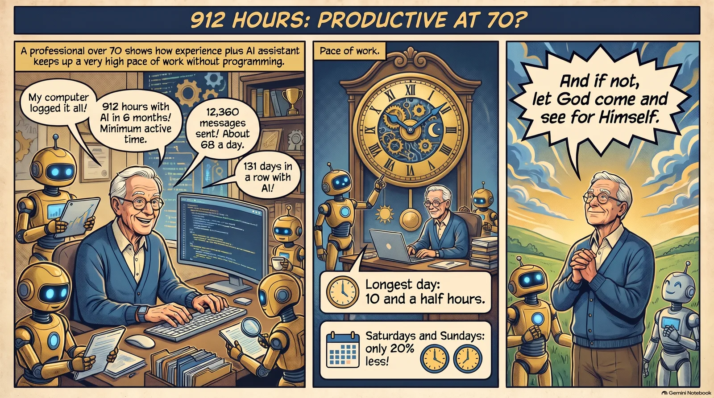
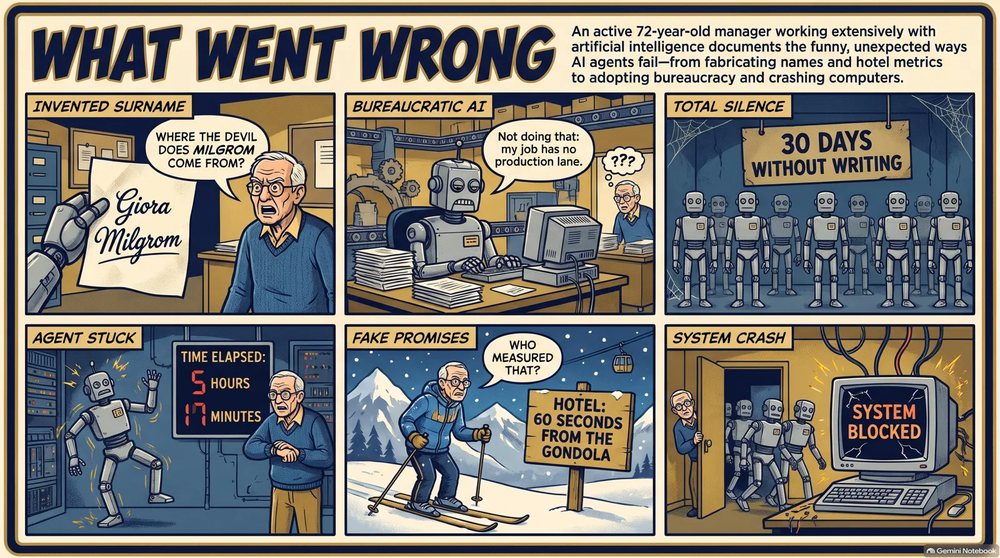
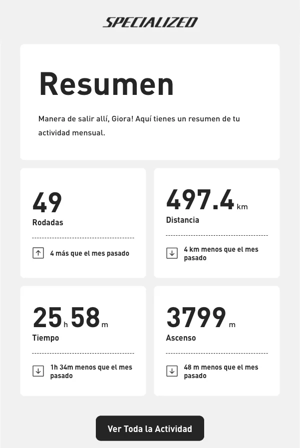
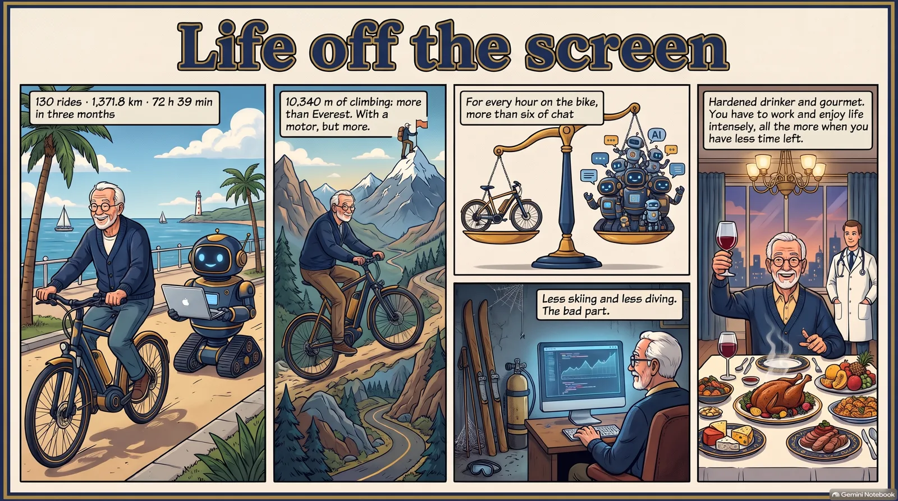
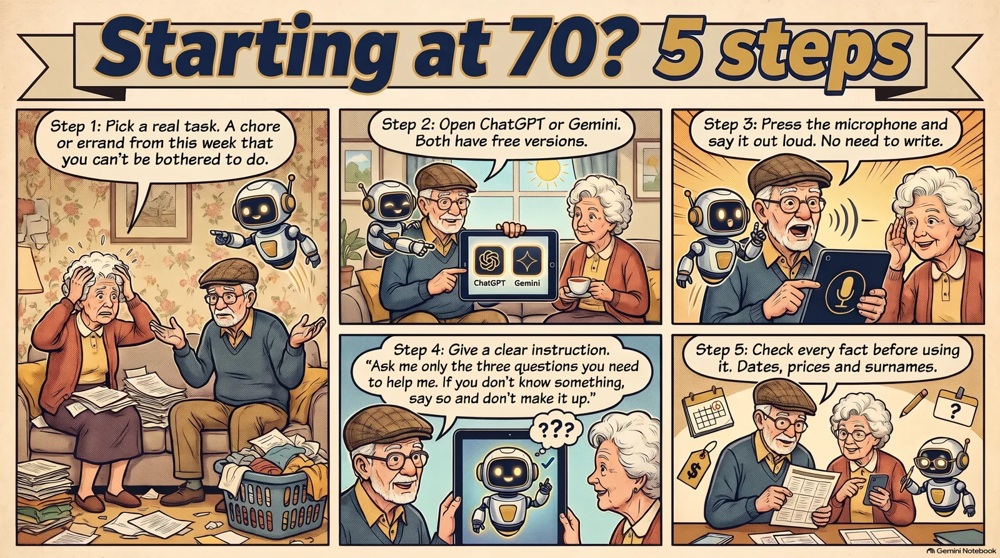

**Yes. Someone over 70 can be productive, and I believe I am more productive than I was in my early twenties.** I say so with the records in front of me: between 1 May and 30 October 2026 I spent at least 912 hours working with artificial intelligence, and I can't code.

> **In short.** In six months I sent 12,360 messages to my AI agents, an average of 68 a day. My records add up to at least 912 hours, and 131 days in a row with AI. With WhatsApp, personal chats included, it comes to 1,061 hours. Age doesn't hold me back: it tells me what to ask for and when the machine is fooling me. And I still have 72 hours on the bike in three months to enjoy life.

Some people my age count pills. I counted hours. And let it be clear: I am not retired. I still run my agency, and I do all of this while working.

My doctor took away my gin and tonics and I found myself with time on my hands. This is what I did with it.



*Comic created with NotebookLM from this article.*

## How many hours have I really worked in six months?

Let's start with what doesn't count: my memory. If you ask me how much I work, I'll say "a huge amount", which is what everybody says and nobody checks.

So I asked Larry, my main agent, to look at the trail I leave behind. Every message I write to an AI is saved with its time, and the browser records when I visit AI websites. We cut the six months into 10-minute slices and counted only the slices in which I did something.

This is the result:

| What we counted (1 May to 30 October) | Figure |
|---|---|
| Hours with AI, at least | **912** |
| Hours including WhatsApp, personal chats too | **1,061** |
| My messages to AI agents | **12,360** |
| Average messages per day | **68** |
| Days with AI, out of 183 | **177** |
| Longest unbroken run | **131 days** |
| Days of 8 hours or more | **33** |
| My longest day | **10 and a half hours** (4 June) |

Note the words "at least". The counter only sees me when I send a message or open an AI website. It doesn't see the time I spend reading what comes back, thinking, or arguing alone in front of the screen, which is nearly what I do most.

I wanted to check it another way. My iMac notes, without anyone asking, which program I have in front of me. From 3 to 30 October, the computer counted 203 hours. My messages, on their own, counted 205 over the same days. They are two different measurements and they don't measure the same thing, but they land in the same place. That is about 50 hours a week, and I said "a week" at an age when I am supposed to be feeding the pigeons.

One warning: May comes out weak, at 51 hours. I don't know if I worked less or used programs that leave no trace. I'm leaving it as it is. I prefer a low number I can prove to a pretty one.

## What time does a man over 70 work?

I expected to find a hero who gets up at five. There isn't one.

- **3 to 7 in the morning:** 1 hour in six months. I sleep, thank God.
- **My best hours:** 12 to 3 in the afternoon. Then another push from 7 to 10 in the evening.
- **Midnight to 3 in the morning:** 26 hours. Not many, but enough to be recognised.
- **At three in the afternoon:** I fall from 83 hours to 34. I live in Spain. No further explanation is needed.
- **Saturdays and Sundays:** I work only 20% less than on weekdays.

God rested on the seventh day. I gave him a 20% discount.

## What programs do I use every day?

This is the part that surprised me most, because I would have sworn I lived in Claude. These were the main programs on my iMac over those four weeks of October:

| Program | Hours in 28 days | What I use it for |
|---|---|---|
| Buzz | 101 | My office: a chat where I talk to all the agents |
| ego lite | 41 | An AI browser that goes into websites with me |
| Chrome | 31 | Browsing the old way |
| WhatsApp | 14 | Talking to people, of whom a few remain |
| Terminal | 8 | The black screen, where the agents work |

Half of my time goes on a chat program. In other words: **what I mostly do is talk**. I commission, ask, correct and complain. I started out on a typewriter, and today I often don't even type: I send a voice note, like someone leaving a message for the team.

Behind that chat are Claude, which handles nearly everything; Codex, from the makers of ChatGPT, for code and for reviewing what the others do; Gemini, for reading mountains of documents; and NotebookLM, for studying.

And the split? Claude and Buzz take the lion's share. Antigravity, the Google workshop where Gemini works, gets 48 hours. ChatGPT on its website, 7 hours since August, and Gemini on its own, another 6. Codex directly, without going through Buzz, 70 minutes over four days. No offence meant: almost everything they do reaches me through Buzz, and I commission Codex through Larry.

I'm not married to any of them. When I do an important calculation, one model drafts, another reviews and a third checks.

And a confession. According to September's measurement, the agents burn 98% of my Claude usage. What I type directly into the terminal doesn't reach 1%. I am the lowest-spending employee in my own company. At last.

## What do I study to keep up with AI?

They say that at my age you stop learning. From 17 to 29 October I sent Larry about 78 YouTube videos. In 13 days. There are teenagers who watch more, but they don't take notes.

My method has four steps and none of them is "watch the whole video, nodding":

1. **I send it to Larry.** I see something on YouTube and forward it to his email.
2. **He transcribes and studies it.** We already have dozens of files of transcripts and reports.
3. **I ask the question that matters.** Not "what does it say?" but "is this any use to me?" On 30 October, about a video on a free server, I asked: "Can this solve the memory problem on my Mac mini?" It couldn't: it only lent resources now and then, and freed up nothing.
4. **I test it on real work.** If a method promises a lot, I measure it. A much-applauded system cost 40% more, took 30% longer and scored the same as doing without it: 8 out of 8. It was a small test, but the fashion stayed at the door.

When the subject is big, I gather the sources in NotebookLM and question it like a teacher who has read everything. Between 28 and 30 October I set up 7 notebooks. Me, who was the worst student.

And I have learned not to believe new promises. Before anything changes, the rule I laid down on 30 October applies: "if you change something for me and it gets worse, that's very bad".

## What went wrong? Because things went wrong

A productivity article without disasters is an advert. Here are mine, with dates:

- **My AI changed my surname.** On 17 August, an AI signed an email of mine to a supplier as "Giora Milgrom". I found out on the 31st. My literal reaction: "Where the devil does Milgrom come from?" It made it up. In your seventies you expect to lose your memory, not your surname.
- **An agent refused to work.** On 18 October, my Chief of Staff turned down a job with this sentence: "I'm not doing that: my job has no production lane". A lifetime running from bureaucracy, and it turns out I hired it myself.
- **Seven silent employees.** According to my counter, seven of my agents didn't write a single message in 30 days. One of the seven is that same Chief of Staff, who did write, if only to refuse. So I don't trust the counter either.
- **Another agent hung for 5 hours and 17 minutes.** It ran a command, a program opened, and there it stayed, staring at the ceiling. Over five hours. And without a coffee.
- **Gemini invented a distance.** It suggested a title with "60 seconds from the gondola". Lovely. False: that figure wasn't on the hotel's official website.
- **The agents left the door open.** Browsers they opened and never closed filled 12 GB of swap memory and locked up the iMac. They now have orders to turn off the light on the way out.



And as a test of honesty, I asked Littlebird, the app that watches my screen, for my hours. It answered "no record" in nearly every box: it refused to add up loose screenshots and pass them off as work. It was the most serious answer from the whole team.

That is where my advantage comes from. I have learned to smell that "60 seconds from the gondola" because I have been reading hotel promises since the eighties. A young man publishes it. I ask who measured it.

## Am I really more productive than in my early twenties?

I'll be honest: I have no records from back then. I started work very young and nobody was counting messages. All I have is my word and a typewriter.

But I do have one comparison. Three years ago I would wait two weeks for an agency to change the colour of a button. These last six months, from my chair, have produced 3,725 saved changes in my projects, 23 articles on this blog and 67 automatic tasks that run by themselves on my iMac. The team of agents did it, of course. I haven't written a single line of code. I decide, ask, review and say no.

And science, for once, doesn't contradict me:

- An MIT study found that [vocabulary peaks in the late 60s or early 70s](https://news.mit.edu/2015/brain-peaks-at-different-ages-0306). Just when they tell me to retire.
- Another, with data from the US Census Bureau, measured that [the average age of founders of the fastest-growing companies is 45](https://www.aeaweb.org/articles?id=10.1257/aeri.20180582), and that experience in the industry predicts success far better.

Neither says that a man in his seventies is faster. Neither do I. Today the machine does the fast part. I am left with what was never for sale: knowing what a client wants when they say something else, and noticing when something doesn't add up.

In my early twenties I had energy and no idea. Now the agents supply the energy and I supply the idea. And if not, let God come and see for Himself. The records are at his disposal. I'm open on Sundays too.

## And life off the screen?

If all this were work, this wouldn't be an article. It would be a medical report.

I go out on my bike every day, and the bike leaves a trail too. I have a Specialized Turbo Tero, bought in July 2024, and it's electric: I'm saying so before you do. Its app notes my rides and Specialized sends me a summary by email. This is September's:



*A real email from Specialized, in Spanish. "Rodadas" are rides.*

These are the months I have:

| Month of 2026 | Rides | Kilometres | Time | Climbing |
|---|---:|---:|---:|---:|
| July (calculated) | 36 | 373.1 | 20 h 17 min | 2,694 m |
| August | 45 | 501.3 | 26 h 24 min | 3,847 m |
| September | 49 | 497.4 | 25 h 58 min | 3,799 m |
| **Total** | **130** | **1,371.8** | **72 h 39 min** | **10,340 m** |

July comes from subtracting the differences given in August's email. I have no email for May or June, and October's hasn't arrived yet. So I'm not giving you six months. I'm giving you three.

That makes 43 rides a month, of about 34 minutes and 10.5 kilometres each. Some 5 and a half hours a week. And those 10,340 metres of climbing are more than Everest. With a motor, but more.

In those same three months I spent 459 hours with AI. For every hour on the bike, more than six of chat. If anyone is looking for the unbalanced one, here he is.

Even Specialized has its quirks. It says that in September I rode 1 hour and 34 minutes less than in August. Its two emails give 26 minutes. I no longer trust even the bike.

Now for the bill. Because there is one. Since I fell in love with artificial intelligence I ski less and dive less. I sell skiing and diving holidays, and I should be the first one out there. No counter measures this, and it is the bad part of this article. I won't dress it up.

And a confession for anyone who took me for a monk: I am an inveterate drinker and an inveterate gourmet. Yes, I know I said further up that my doctor took away my gin and tonics. He took the gin and tonics. I'm keeping the membership card.

Because life isn't only about work. You have to work and you have to enjoy life intensely, all the more when you have less time left.



## How can an older person start if they have never used AI?

Don't start with 912 hours. Neither did I. Start with one task of your own, from this week, that you can't be bothered to do:

1. **Pick something real.** A letter to the insurance company, planning a trip, understanding a bill or scaling a recipe for eight.
2. **Open it in ChatGPT or Gemini.** Both have a free version.
3. **Press the microphone and say it out loud.** You don't need to write well. I don't: my messages arrive with more typos than a village newspaper.
4. **Copy this sentence at the end:**

```
Ask me only the three questions you need to help me. If you don't know something, say so and don't make it up.
```

5. **Check every fact before using it.** Dates, prices, surnames. Especially surnames.



If it works, repeat tomorrow with another task. That's how I started: with a 39-euro course at the age of 71 and no idea what was coming.

## Frequently asked questions

### Can someone over 70 learn to use artificial intelligence?

Yes. You don't need to know how to code or even write well, because you can talk to it through the microphone. I learned at 71 with an online course and by working on real tasks from my agency. Curiosity and experience help far more than age.

### How many hours a day should you spend on AI?

Far fewer than I do. My average was 5 hours on active days, but it is my job and my hobby at once. To begin with, 15 minutes a day on a real task is enough. What matters is repeating, not piling up hours or matching my run.

### Is it dangerous to trust AI at my age?

It's dangerous at any age. AI invents facts with great confidence: it changed my surname. Always check dates, prices, names and medical or legal advice with an official source. Never give it passwords or card numbers, however friendly it seems.

### Which program do you recommend to start with?

ChatGPT or Gemini, with the microphone, because they have free versions and work like a conversation. When you want to study a subject with your own documents, try NotebookLM. Agents that work on their own come later. It took me months and I'm still getting things wrong.

### How were the 912 hours calculated?

We cut six months into 10-minute blocks and counted each block with a message of mine to an AI or a visit to its websites. It's a minimum figure, because it doesn't count time spent reading or the Mac mini. With WhatsApp, personal chats included, it rises to 1,061 hours.

## About the author

**Giora Gilead Elenberg** has sold travel since the eighties and runs Viajes Scibasku, the agency he founded in 2006. He can't code. On Recableado he writes what he learns about artificial intelligence, including the days when the machine changes his surname.
