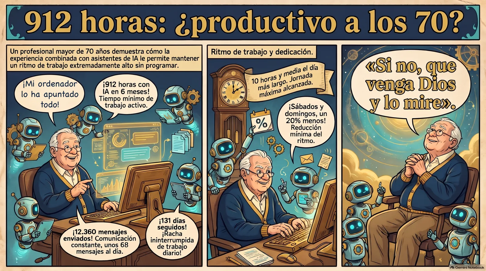
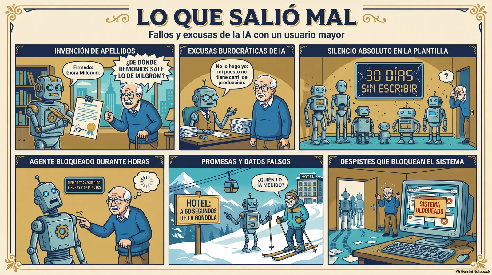
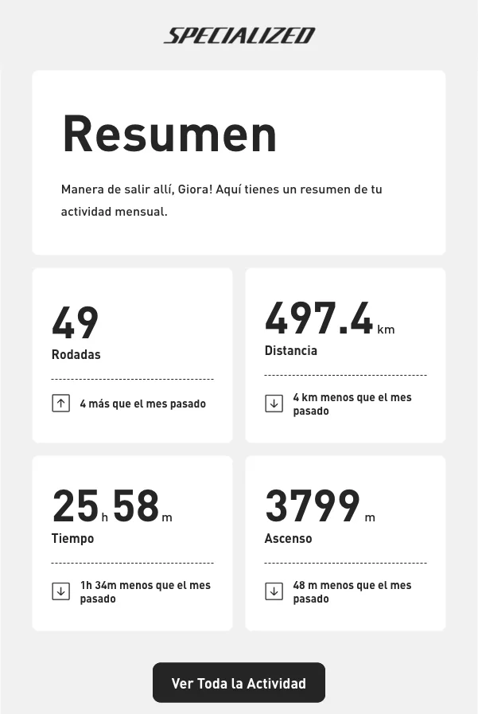
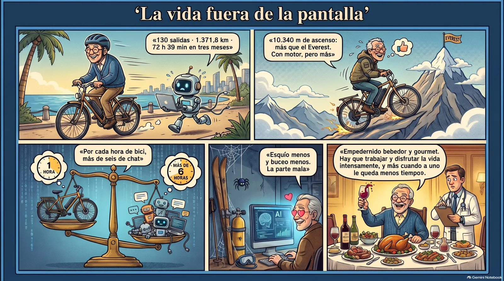
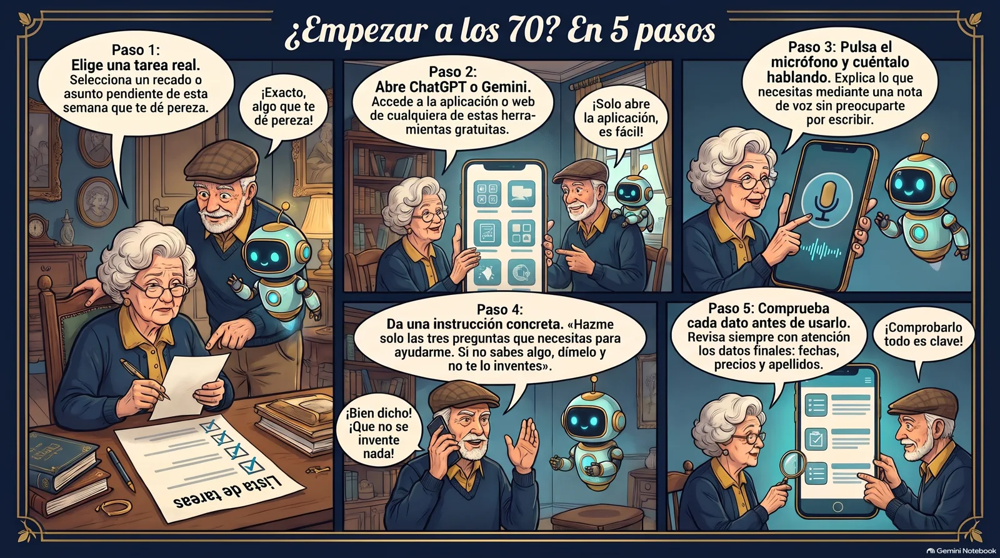

**Sí. Una persona de más de 70 años puede ser productiva, y yo creo que lo soy más que cuando tenía veintipocos.** Lo digo con los registros delante: entre el 1 de mayo y el 30 de octubre de 2026 pasé al menos 912 horas trabajando con inteligencia artificial, y no sé programar.

> **En corto.** En seis meses mandé 12.360 mensajes a mis agentes de IA, una media de 68 al día. Mis registros suman 912 horas como mínimo, y 131 días seguidos con IA. Con WhatsApp, incluido el personal, son 1.061 horas. La edad no me frena: me sirve para saber qué pedir y cuándo la máquina me engaña. Y aún me quedan 72 horas de bici en tres meses para disfrutar de la vida.

Hay quien a mi edad cuenta pastillas. Yo he contado horas. Y que conste: no estoy jubilado. Sigo al frente de mi agencia, y todo esto lo hago trabajando.

Mi médico me quitó los gin tonics y me sobró tiempo. Esto es lo que hice con él.



*Cómic creado con NotebookLM a partir de este artículo.*

## ¿Cuántas horas he trabajado de verdad en seis meses?

Empecemos por lo que no vale: mi memoria. Si me preguntas cuánto trabajo, te diré «muchísimo», que es lo que dice todo el mundo y nadie comprueba.

Así que le pedí a Larry, mi agente principal, que mirara la huella que dejo. Cada mensaje que escribo a una IA queda guardado con su hora, y el navegador apunta cuándo entro en sus webs. Partimos los seis meses en trozos de 10 minutos y solo contamos los trozos en los que hice algo.

Este es el resultado:

| Qué contamos (1 de mayo a 30 de octubre) | Cifra |
|---|---|
| Horas con IA, como mínimo | **912** |
| Horas sumando WhatsApp, incluido el personal | **1.061** |
| Mensajes míos a agentes de IA | **12.360** |
| Media de mensajes al día | **68** |
| Días con IA, de 183 posibles | **177** |
| Racha sin fallar un día | **131 días** |
| Días de 8 horas o más | **33** |
| Mi día más largo | **10 horas y media** (4 de junio) |

Fíjate en la palabra «mínimo». El contador solo me ve cuando envío un mensaje o abro la web de una IA. No ve el rato que paso leyendo lo que me devuelven, pensando o discutiendo solo delante de la pantalla, que es casi lo que más hago.

Quise comprobarlo por otro lado. Mi iMac apunta sin que nadie se lo pida qué programa tengo delante. Del 3 al 30 de octubre, el ordenador contó 203 horas. Mis mensajes, por su cuenta, contaron 205 en esos mismos días. Son dos medidas distintas y no miden lo mismo, pero caen en el mismo sitio. Eso son unas 50 horas a la semana, y he dicho «a la semana» a una edad en la que se supone que debería estar dando de comer a las palomas.

Con una advertencia: mayo sale flojo, con 51 horas. No sé si trabajé menos o si usé programas que no dejan huella. Lo dejo así. Prefiero un número bajo y comprobable a uno bonito.

## ¿A qué hora trabaja un señor de más de 70 años?

Aquí esperaba encontrar a un héroe levantado a las cinco. No lo hay.

- **De 3 a 7 de la mañana:** 1 hora en seis meses. Duermo, gracias a Dios.
- **Mis mejores horas:** de 12 a 15. Después, otro empujón de 19 a 22.
- **De 0 a 3 de la madrugada:** 26 horas. Poco, pero suficientes para que me reconozca.
- **A las tres de la tarde:** caigo de 83 horas a 34. Soy español. No voy a dar más explicaciones.
- **Sábados y domingos:** trabajo solo un 20 % menos que entre semana.

Dios descansó el séptimo día. Yo le he hecho un descuento del 20 %.

## ¿Qué programas uso cada día?

Esta es la parte que más me sorprendió, porque yo habría jurado que vivía en Claude. Estos son los programas principales de mi iMac durante esas cuatro semanas de octubre:

| Programa | Horas en 28 días | Para qué lo uso |
|---|---|---|
| Buzz | 101 | Mi oficina: un chat donde hablo con todos los agentes |
| ego lite | 41 | Navegador con IA, que entra en las webs conmigo |
| Chrome | 31 | Navegar a la antigua |
| WhatsApp | 14 | Hablar con personas, que todavía quedan |
| Terminal | 8 | La pantalla negra, donde trabajan los agentes |

La mitad de mi tiempo se va en un programa de chat. Es decir: **lo que hago, sobre todo, es hablar**. Encargo, pregunto, corrijo y protesto. Empecé con una máquina de escribir y hoy muchas veces ni tecleo: mando una nota de voz, como quien deja un recado al equipo.

Detrás de ese chat trabajan Claude, que lleva casi todo; Codex, de la casa de ChatGPT, para el código y para revisar lo que hacen los demás; Gemini, para leer montañas de documentos; y NotebookLM, para estudiar. 

¿Y el reparto? Claude y Buzz se llevan la parte del león. Antigravity, el taller de Google donde trabaja Gemini, se queda con 48 horas. ChatGPT por su web, 7 horas desde agosto, y Gemini por la suya, otras 6. Codex directo, sin pasar por Buzz, 70 minutos en cuatro días. No es desprecio: casi todo lo que hacen me llega por Buzz, y a Codex se lo encargo a través de Larry.

No me caso con ninguno. Cuando hago un cálculo importante, un modelo hace el borrador, otro lo revisa y un tercero comprueba.

Y una confesión. Según la medición de septiembre, los agentes gastan el 98 % de mi consumo de Claude. Lo que yo escribo directamente en la terminal no llega al 1 %. Soy el empleado que menos gasta de mi empresa. Por fin uno.

## ¿Qué estudio para estar al día con la IA?

A mi edad se dice que ya no se aprende. Del 17 al 29 de octubre le mandé a Larry unos 78 vídeos de YouTube. En 13 días. Hay adolescentes que ven más, pero no toman apuntes.

Mi método tiene cuatro pasos y ninguno es «ver el vídeo entero mientras asiento»:

1. **Se lo mando a Larry.** Veo algo en YouTube y lo reenvío a su correo.
2. **Lo transcribe y lo estudia.** Ya tenemos decenas de ficheros entre transcripciones e informes.
3. **Hago la pregunta que importa.** No «qué dice», sino «¿me sirve a mí?». El 30 de octubre, ante un vídeo de un servidor gratis, pregunté: «¿Puede esto solucionar el problema de memoria de mi Mac mini?». No lo solucionaba: era un préstamo a ratos y no liberaba nada.
4. **Lo pruebo con trabajo real.** Si un método promete mucho, lo mido. Un sistema muy aplaudido costó un 40 % más, tardó un 30 % más y acertó lo mismo que sin él: 8 de 8. Fue una prueba pequeña, pero la moda se quedó en la puerta.

Cuando el tema es grande, reúno las fuentes en NotebookLM y le hago preguntas como a un profesor que se ha leído todo. Entre el 28 y el 30 de octubre monté 7 cuadernos. Yo, que era el peor estudiante.

Y he aprendido a no creerme las promesas nuevas. Antes de cambiar nada, vale la regla que dejé clara el 30 de octubre: «si me cambias algo y va peor, muy mal».

## ¿Qué ha salido mal? Porque ha salido mal

Un artículo de productividad sin desastres es un anuncio. Aquí van los míos, con fecha:

- **Mi IA me cambió el apellido.** El 17 de agosto, una IA firmó un correo mío a un proveedor como «Giora Milgrom». Lo descubrí el 31. Mi reacción literal: «¿De dónde demonios sale lo de Milgrom?». Se lo inventó. Con setenta y tantos años uno espera perder la memoria, no el apellido.
- **Un agente se negó a trabajar.** El 18 de octubre, mi Jefe de Gabinete rechazó un encargo con esta frase: «no lo hago yo: mi puesto no tiene carril de producción». Toda la vida huyendo de la burocracia y resulta que me la he contratado yo.
- **Siete empleados mudos.** Según mi contador, siete de mis agentes no escribieron ni un mensaje en 30 días. Uno de los siete es ese Jefe de Gabinete, que sí escribió, aunque fuera para negarse. Así que tampoco me fío del contador.
- **Otro agente se quedó 5 horas y 17 minutos colgado.** Lanzó un comando, se abrió un programa y allí se quedó, mirando al techo. Más de cinco horas. Y sin café.
- **Gemini inventó una distancia.** Me propuso un título con «A 60 segundos de la góndola». Precioso. Falso: ese dato no estaba en la web oficial del hotel.
- **Los agentes dejaron la puerta abierta.** Los navegadores que abrían y no cerraban llenaron 12 GB de memoria de intercambio y bloquearon el iMac. Ahora tienen orden de apagar la luz al salir.



Y como prueba de honradez, le pedí a Littlebird, la app que observa mi pantalla, que me diera mis horas. Me contestó «sin registro» en casi todas las casillas: no quiso sumar capturas sueltas y hacerlas pasar por trabajo. Fue la respuesta más seria de todo el equipo.

De ahí sale mi ventaja. Yo he aprendido a oler ese «a 60 segundos de la góndola» porque llevo desde los años ochenta leyendo promesas de hoteles. Un joven lo publica. Yo pregunto quién lo ha medido.

## ¿De verdad soy más productivo que a los veintipocos?

Voy a ser honrado: no tengo registros de aquello. Empecé a trabajar muy joven y entonces nadie contaba mensajes. Solo tengo mi palabra y una máquina de escribir.

Pero sí tengo una comparación. Hace tres años esperaba dos semanas a que una agencia me cambiara el color de un botón. Estos seis meses, desde mi silla, han salido 3.725 cambios guardados en mis proyectos, 23 artículos en este blog y 67 tareas automáticas que corren solas en mi iMac. Lo hizo el equipo de agentes, claro. Yo no he escrito ni una línea de código. Yo decido, pregunto, reviso y digo que no.

Y la ciencia, por una vez, no me lleva la contraria:

- Un estudio del MIT encontró que [el vocabulario llega a su punto más alto a finales de los 60 o principios de los 70](https://news.mit.edu/2015/brain-peaks-at-different-ages-0306). Justo cuando me dicen que me jubile.
- Otro, con datos de la Oficina del Censo de Estados Unidos, midió que [la edad media de quien funda las empresas que más crecen es de 45 años](https://www.aeaweb.org/articles?id=10.1257/aeri.20180582), y que la experiencia en el sector predice mucho mejor el éxito.

Ninguno dice que un señor de setenta y tantos sea más rápido. Yo tampoco. Hoy lo rápido lo hace la máquina. A mí me queda lo que no estaba en venta: saber qué quiere un cliente cuando dice otra cosa y notar cuándo algo no cuadra.

A los veintipocos yo tenía energía y ni idea. Ahora la energía la ponen los agentes y la idea la pongo yo. Y si no, que venga Dios y lo mire. Tiene los registros a su disposición. Los domingos también abro.

## ¿Y la vida fuera de la pantalla?

Si todo esto fuera trabajar, esto no sería un artículo. Sería un parte médico.

Salgo en bici todos los días, y la bici también deja huella. Tengo una Specialized Turbo Tero, comprada en julio de 2024, y es eléctrica: lo digo yo antes de que me lo digas tú. Su app apunta las salidas y Specialized me manda un resumen al correo. Este es el de septiembre:



*Correo real de Specialized. Sí, llama «rodadas» a las salidas. Yo no traduzco a Specialized.*

Estos son los meses que tengo:

| Mes de 2026 | Salidas | Kilómetros | Tiempo | Ascenso |
|---|---:|---:|---:|---:|
| Julio (calculado) | 36 | 373,1 | 20 h 17 min | 2.694 m |
| Agosto | 45 | 501,3 | 26 h 24 min | 3.847 m |
| Septiembre | 49 | 497,4 | 25 h 58 min | 3.799 m |
| **Total** | **130** | **1.371,8** | **72 h 39 min** | **10.340 m** |

Julio sale de restar las diferencias que trae el correo de agosto. De mayo y junio no conservo ningún correo, y el de octubre aún no ha llegado. Así que no te doy los seis meses. Te doy tres.

Salen 43 salidas al mes, de unos 34 minutos y 10,5 kilómetros cada una. Unas 5 horas y media a la semana. Y esos 10.340 metros de ascenso son más que el Everest. Con motor, pero más.

En esos mismos tres meses pasé 459 horas con la IA. Por cada hora de bici, más de seis de chat. Si alguien busca al desequilibrado, ya lo tiene.

Y hasta Specialized tiene sus cosas. Dice que en septiembre pedaleé 1 hora y 34 minutos menos que en agosto. Sus dos correos dan 26 minutos. Ya no me fío ni de la bici.

Ahora, la factura. Porque la hay. Desde que me enamoré de la inteligencia artificial esquío menos y buceo menos. Vendo viajes de esquí y de buceo, y soy el primero que debería estar ahí. Esto no lo mide ningún contador y es la parte mala de este artículo. No la voy a maquillar.

Y una confesión para quien me haya tomado por un monje: soy un empedernido bebedor y un empedernido gourmet. Sí, ya sé que más arriba he contado que mi médico me quitó los gin tonics. Los gin tonics me los quitó él. El carné me lo quedo yo.

Porque la vida no consiste solo en trabajar. Hay que trabajar y hay que disfrutar la vida intensamente, y más cuando a uno le queda menos tiempo.



## ¿Cómo puede empezar alguien mayor que nunca ha usado IA?

No empieces por 912 horas. Yo tampoco. Empieza por una tarea tuya, de esta semana, que te dé pereza:

1. **Elige una cosa real.** Una carta al seguro, ordenar un viaje, entender una factura o preparar una receta para ocho.
2. **Ábrela en ChatGPT o en Gemini.** Las dos tienen versión gratuita.
3. **Pulsa el micrófono y cuéntalo hablando.** No tienes que saber escribir bien. Yo tampoco; mis mensajes llegan con más erratas que un periódico de pueblo.
4. **Copia esta frase al final:**

```
Hazme solo las tres preguntas que necesitas para ayudarme. Si no sabes algo, dímelo y no te lo inventes.
```

5. **Comprueba cada dato antes de usarlo.** Fechas, precios, apellidos. Sobre todo apellidos.



Si funciona, repite mañana con otra tarea. Así empecé yo: con un curso de 39 euros a los 71 años y sin ninguna idea de lo que venía.

## Preguntas frecuentes

### ¿Puede una persona de más de 70 años aprender a usar inteligencia artificial?

Sí. No hace falta saber programar ni escribir bien, porque puedes hablarle con el micrófono. Yo aprendí a los 71 años con un curso online y trabajando con tareas reales de mi agencia. La curiosidad y la experiencia ayudan mucho más que la edad.

### ¿Cuántas horas al día hay que dedicarle a la IA?

Muchas menos que yo. Mi media fue de 5 horas los días con actividad, pero es mi trabajo y mi afición a la vez. Para empezar bastan 15 minutos al día con una tarea real. Lo importante es repetir, no acumular horas ni llegar a mi racha.

### ¿Es peligroso fiarse de la IA a mi edad?

Es peligroso a cualquier edad. La IA inventa datos con mucha seguridad: a mí me cambió el apellido. Comprueba siempre fechas, precios, nombres y consejos médicos o legales en una fuente oficial. Nunca le des contraseñas ni números de tarjeta aunque parezca muy amable.

### ¿Qué programa recomiendas para empezar?

ChatGPT o Gemini, con el micrófono, porque tienen versión gratuita y se manejan como una conversación. Cuando quieras estudiar un tema con tus documentos, prueba NotebookLM. Los agentes que trabajan solos llegan después. Yo tardé meses y sigo equivocándome.

### ¿Cómo se han calculado las 912 horas?

Partimos seis meses en bloques de 10 minutos y contamos cada bloque con un mensaje mío a una IA o una visita a sus webs. Es una cifra mínima, porque no cuenta el tiempo leyendo ni el Mac mini. Con WhatsApp, que incluye lo personal, sube a 1.061 horas.

## Sobre el autor

**Giora Gilead Elenberg** vende viajes desde los años ochenta y dirige Viajes Scibasku, la agencia que fundó en 2006. No sabe programar. Escribe en Recableado lo que aprende con la inteligencia artificial, incluidos los días en que la máquina le cambia el apellido.
